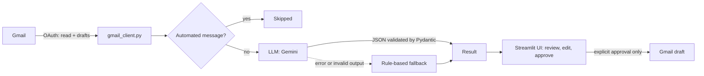

# AI Email Assistant

An AI-powered email assistant built with Python. It reads incoming emails, classifies them,
detects their urgency, and generates a reply **draft** that a human must review and approve.
**It never sends an email automatically.**

> Portfolio project: AI automation, LLM integration with validated outputs, Gmail OAuth, and a Streamlit UI.

<!-- Add a screenshot:  -->

## Features

- **Classification**: Recruitment, Meeting, Finance, General.
- **Priority detection**: High (urgent, deadline, ASAP) or Normal.
- **AI reply drafts**: polite, professional, written in the language of the email.
- **Human approval**: the draft is editable; approval requires an explicit review checkbox,
  and editing the draft cancels a previous approval.
- **Gmail integration (OAuth)**: loads unread emails and saves replies as **Gmail drafts** in the same thread.
- **Automatic-mail filter**: newsletters, promotions and no-reply senders are skipped
  (no LLM call, no draft).
- **Graceful degradation**: if the LLM is unavailable or returns invalid output,
  the app falls back to rule-based classification instead of crashing.

## Architecture



## Safety and design decisions

- **No automatic sending.** The code only calls Gmail's *create draft* endpoint. A unit test scans
  the source files and fails if any send call is ever added. (Gmail's `compose` permission technically
  allows sending, so this guarantee is enforced in code, not by the permission.)
- **Validated LLM output.** The model must answer in JSON; Pydantic checks the category, the priority
  and the required fields. Anything invalid triggers the rule-based fallback.
- **Prompt-injection awareness.** The email is passed as data between tags and the model is told never
  to follow instructions found inside it. The prompt also forbids inventing facts, dates or amounts;
  missing details become placeholders such as `[Your name]`.
- **Header-injection protection.** Reply headers containing line breaks are rejected.
- **Secrets stay out of the code.** API keys live in `.env`; `credentials.json` and `token.json` are git-ignored.

## Tech stack

Python, Pydantic, Google Gemini API (`google-genai`), Gmail API (`google-api-python-client`,
`google-auth-oauthlib`), Streamlit, pytest, python-dotenv.

## Project structure

```
AI-Email-Assistant/
├── app.py                  # Streamlit interface
├── email_assistant.py      # Rule-based classification and priority
├── llm_assistant.py        # LLM analysis + reply drafts + fallback
├── gmail_client.py         # Gmail OAuth, reading, draft creation
├── models.py               # Pydantic models
├── main.py                 # Rule-based demo
├── demo_llm.py             # LLM demo
├── demo_gmail.py           # Gmail demo (terminal)
├── tests/                  # pytest suite (no network, no API key needed)
├── requirements.txt
└── .env.example
```

## Installation

```powershell
git clone https://github.com/<your-username>/ai-email-assistant.git
cd ai-email-assistant
python -m venv .venv
.\.venv\Scripts\Activate.ps1        # macOS/Linux: source .venv/bin/activate
pip install -r requirements.txt
```

## Configuration

**1. LLM key.** Create a Gemini API key in [Google AI Studio](https://aistudio.google.com),
copy `.env.example` to `.env` and fill it in:

```
GEMINI_API_KEY=your-key
GEMINI_MODEL=<a current model name from AI Studio>
```

Model names change over time; check AI Studio if you get a `404 model not found` error.

**2. Gmail (optional).** In [Google Cloud Console](https://console.cloud.google.com):

1. Create a project and enable the **Gmail API**.
2. Configure the OAuth consent screen (External, status **Testing**) and add your Gmail address as a **test user**.
3. Create an **OAuth client ID** of type **Desktop app** and download the JSON.
4. Save it as `credentials.json` in the project root.

The first run opens your browser to authorize access. In Testing mode, the authorization expires after about 7 days.

## Usage

```powershell
streamlit run app.py        # web interface
python demo_gmail.py        # terminal demo with Gmail
python demo_llm.py          # LLM demo on sample emails
python main.py              # rule-based demo (no API key needed)
```

**Workflow in the app:** load unread emails (or paste one) → **Analyze** → edit the draft →
tick the review checkbox → **Approve** → **Save as Gmail draft** → review and send it yourself from Gmail.

## Tests

```powershell
python -m pytest -v
```

The tests use fake clients, so they need no network, no API key and no Gmail account.
They cover classification, LLM output validation and fallback, Gmail parsing, draft creation,
automated-mail detection, the "never sends" guarantee, and the approval flow of the UI.

## Privacy note

Email content is sent to the LLM provider. Free API tiers may use submitted data to improve their products.
For testing, use a dedicated test mailbox with fictional emails.

## Limitations and roadmap

- Rule-based fallback is keyword-based and English-oriented.
- Automated-mail detection is heuristic (headers and Gmail categories).
- Planned: n8n workflow (Gmail → AI → notification), keeping human approval mandatory.